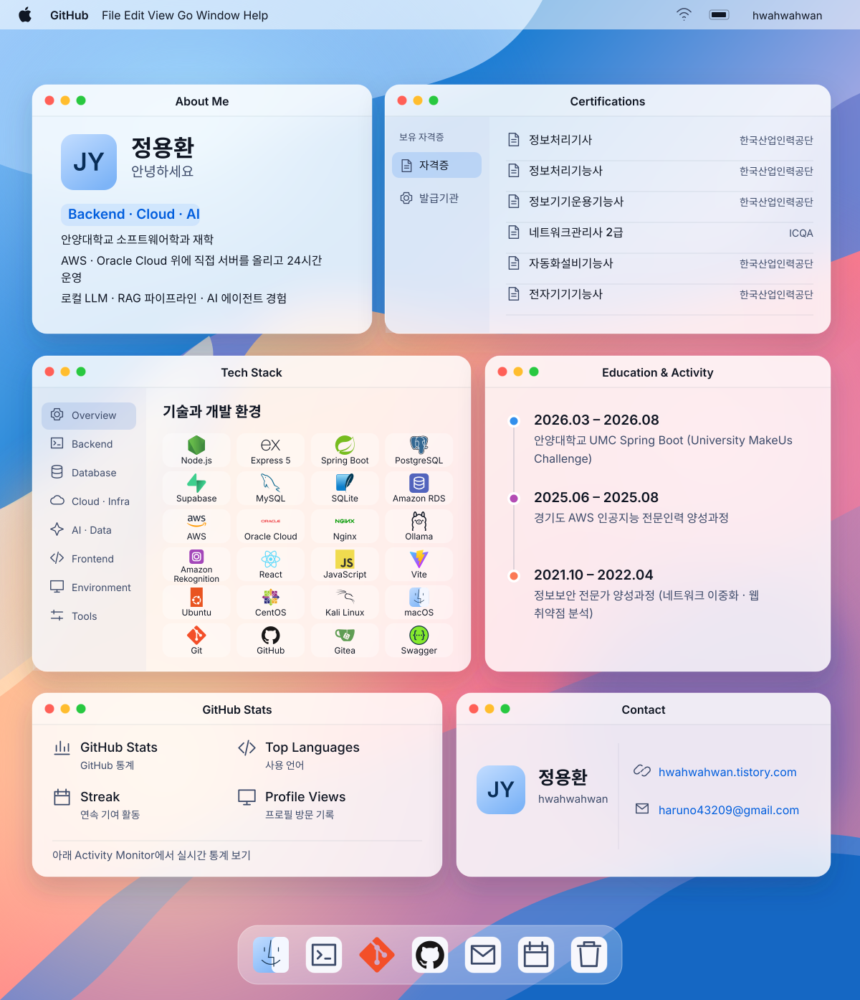

<!-- 별도 초안: 원본 README와 기존 동적 이미지 URL 보존. -->
<picture>
  <source media="(max-width: 600px) and (prefers-color-scheme: dark)" srcset="./assets/desktop-dark-mobile.svg">
  <source media="(max-width: 600px)" srcset="./assets/desktop-light-mobile.svg">
  <source media="(prefers-color-scheme: dark)" srcset="./assets/desktop-dark.svg">
  
</picture>

<a href="https://hwahwahwan.tistory.com">Blog</a> · <a href="mailto:haruno43209@gmail.com">Email</a>

<picture><source media="(max-width: 600px) and (prefers-color-scheme: dark)" srcset="./assets/activity-title-dark-mobile.svg"><source media="(max-width: 600px)" srcset="./assets/activity-title-light-mobile.svg"><source media="(prefers-color-scheme: dark)" srcset="./assets/activity-title-dark.svg"></picture>

<table><tr><td>

 

 

 

</td></tr></table>

[Stats 원본](https://github-readme-stats.vercel.app/api?username=hwahwahwan&show_icons=true&theme=tokyonight&hide_border=true) · [Languages 원본](https://github-readme-stats.vercel.app/api/top-langs/?username=hwahwahwan&layout=compact&theme=tokyonight&hide_border=true) · [Streak 원본](https://streak-stats.demolab.com?user=hwahwahwan&theme=tokyonight&hide_border=true) · [Views 원본](https://komarev.com/ghpvc/?username=hwahwahwan&color=58A6FF&style=flat-square)

<picture><source media="(max-width: 600px) and (prefers-color-scheme: dark)" srcset="./assets/about-title-dark-mobile.svg"><source media="(max-width: 600px)" srcset="./assets/about-title-light-mobile.svg"><source media="(prefers-color-scheme: dark)" srcset="./assets/about-title-dark.svg"></picture>

# 안녕하세요 👋 정용환입니다

생각한 것은 구현하며 배워갑니다.  
백엔드·클라우드를 공부하며 직접 만들고 운영해 보는 대학생입니다.

- 안양대학교 소프트웨어학과 재학
- AWS · Oracle Cloud 위에 직접 서버를 올리고 24시간 운영
- 로컬 LLM · RAG 파이프라인 · AI 에이전트 경험

## Contact

[Blog](https://hwahwahwan.tistory.com) · [Email](mailto:haruno43209@gmail.com)

## Tech Stack

| 분류 | 기술 |
| --- | --- |
| Backend | Node.js · Express 5 · Spring Boot |
| Database | PostgreSQL · Supabase · MySQL · SQLite · Amazon RDS |
| Cloud · Infra | AWS · Oracle Cloud · Nginx |
| AI · Data | Ollama · Amazon Rekognition |
| Frontend | React · JavaScript · Vite |
| OS · Environment | Ubuntu · CentOS · Kali Linux · macOS |
| Tools | Git · GitHub · Gitea · Swagger |

## Education & Activity

- **2026.03 – 2026.08**: 안양대학교 UMC Spring Boot (University MakeUs Challenge)
- **2025.06 – 2025.08**: 경기도 AWS 인공지능 전문인력 양성과정
- **2021.10 – 2022.04**: 정보보안 전문가 양성과정 (네트워크 이중화 · 웹 취약점 분석)

## Certifications

- 정보처리기사 — 한국산업인력공단
- 정보처리기능사 — 한국산업인력공단
- 정보기기운용기능사 — 한국산업인력공단
- 네트워크관리사 2급 — ICQA
- 자동화설비기능사 — 한국산업인력공단
- 전자기기기능사 — 한국산업인력공단

